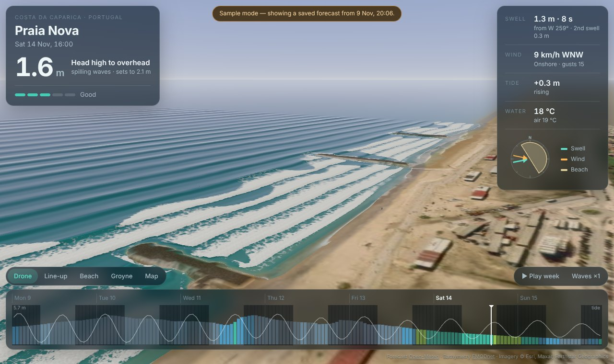
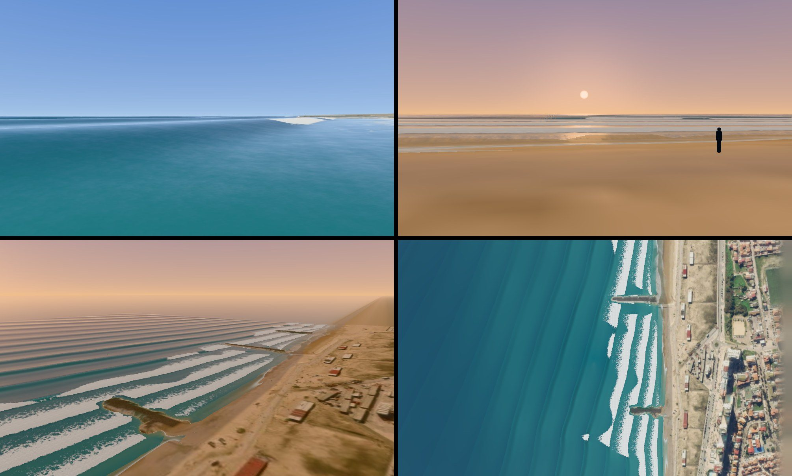
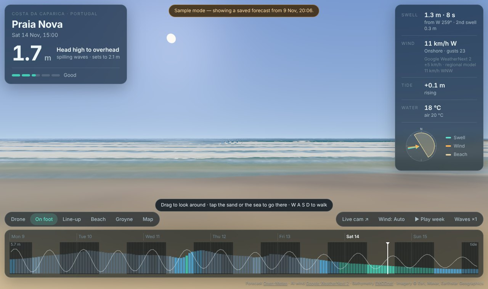

# Wave Forecast — see the surf in 3D

A surf forecast you **watch** instead of read. It rebuilds a real beach in 3D — seabed, sand,
groynes, satellite photo — and runs the live swell, wind and tide forecast across it, so you can
see how the waves will bend, stand up and break at that exact spot, hour by hour for the next week.

First beach: **Praia Nova, Costa da Caparica, Portugal**.





## Run it

```bash
npm install
npm run dev      # then open the address it prints
```

Other commands: `npm run build` (static site in `dist/`, host it anywhere), `npm test`,
`npm run bake` (rebuild the beach terrain from open data).

### Live site

Every change merged into `main` is tested, built and published to GitHub Pages by
`.github/workflows/deploy.yml`. One-off setup: repository **Settings → Pages → Source: GitHub
Actions**. The site then lives at `https://<your-github-user>.github.io/Wave-Forecast/`.

No API keys are needed.

## Using it

- **Timeline** (bottom): drag to scrub through 7 days. Bars are breaking-wave height, coloured by
  surf rating; the white line is the tide; dark bands are night. `←` `→` step an hour, `space` plays.
- **Cameras**: Drone, Line-up (you bob on the swell next to a surfer), Beach (a person stands at
  the swash line for scale), Groyne, Map. Drag to orbit, scroll or pinch to zoom.
- **Free**: fly the camera yourself. Drag to move over the beach, right-drag or two fingers to
  turn and tilt, scroll or pinch to zoom, `W A S D` to glide.
- **On foot**: you, 1.7 m tall, standing on the sand. Drag to look around, tap the sand or the sea
  to go there (or walk with `W A S D`). Wade in and the readout tells you how deep you are and how
  big the waves are against your body; past your depth you float and rise with each wave.
- **Wind: Auto / Hi-res / Google AI** picks the wind forecast (see below). The wind panel always
  shows both, the AI's uncertainty (±km/h), and flags hours where the two disagree.
- **Live cam ↗** opens the nearest public webcam on its own site, to compare with reality.
- **Waves ×1 / ×1.5 / ×2** exaggerates wave height so it reads from far away. ×1 is true scale.
- The scene is lit for the forecast hour: real sun position, cloud cover, sunsets over the sea.

### Experiment mode

Override the conditions from the address bar to see what a given swell would do here:

```
?swell=1.5,13,290     height m, period s, direction it comes from
&wind=15,60           speed km/h, direction it comes from
&tide=0.5             metres above mean sea level
&cloud=10             percent
&cam=lineup           drone | walk | lineup | beach | groyne | top
&windsrc=google       auto | local | google
&hour=2026-11-14T16:00Z   which forecast hour to open
&sample               use the saved forecast instead of the live one
&ui=0                 hide the panels (clean screenshots)
```

## How it works

```
 Satellite photo ─┐
 (Esri imagery)   ├─► scripts/bake-beach.mjs ─► public/data/<beach>/  (height map + masks)
 EMODnet seabed ──┘         one-off, offline

 Open-Meteo marine + weather ─► src/data/forecast.js ─► one sea state per hour
                                         │
                                         ▼
                       src/physics/nearshore.js   (runs in the browser, ~0.1 s per hour)
                         1. Snell refraction + directional spreading from the forecast
                            point to the edge of the patch (sheltered directions lose energy)
                         2. Eikonal travel-time solve over the real seabed → curved, slowing crests
                         3. Energy-flux conservation → shoaling, focusing on bars, groyne shadows
                         4. Depth-limited breaking → where each wave breaks, and how big
                                         │
                                         ▼
                       src/scene/*   three.js: the fields become data textures; a shader
                                     animates every crest, set, bore, foam trail and swash
```

**Terrain from satellite.** The bake script reads the satellite tiles pixel by pixel: sea is
flood-filled in from offshore, the waterline is traced, and rock that sticks out past the natural
beach line is recognised as a groyne (it found all three in the patch). Depths come from the
EMODnet survey grid. Close to shore, where no open survey resolves sandbars, a Dean equilibrium
beach profile is blended in and nudged by where the photo shows white water (foam marks shallow
bars).

**Waves.** Each wave train carries a travel-time field: a crest is simply a line of equal travel
time, so crests refract, slow and bunch up exactly as the seabed dictates. Waves arrive in sets;
bigger set waves break further out. The headline number is the breaking height in front of the
middle of the beach, with the breaker type from the Iribarren number.

**Rating.** `src/model/seaState.js → rate()` is a small, readable heuristic (size, period, wind
relative to the beach). Tune it to your taste.

## The science behind the waves

What the model does, and the literature each piece rests on.

**How waves are built.** Wind blows over the sea and grows waves; once they outrun the wind they
become swell, which travels thousands of kilometres with little loss. Near a coast the seabed takes
over: waves slow down (refraction bends the crests towards the beach), bunch up (shoaling makes them
taller) and break when height reaches roughly 0.78 of the depth (the breaking index; McCowan 1894,
Battjes & Janssen 1978). All of that is solved over the real seabed in `src/physics/nearshore.js`.

**Swell and wind sea together ("synergy").** A real sea is usually two or more systems at once.
- Independent systems add in *energy*, not height: a 2 m swell plus a 1 m wind sea is 2.2 m, not
  3 m (`Math.hypot` in `src/model/seaState.js`).
- Swell and wind sea interact nonlinearly, strongest when they meet at roughly 40-60 degrees; the
  result is a lumpier, less organised surface ("crossing seas") and occasionally larger crests
  (Hasselmann et al. 1973; Resio & Perrie 2009; Frontiers in Marine Science 2022). The app measures
  the angle between the swell and the wind sea and roughens the water accordingly.
- Real swell arrives in groups, which is why sets of bigger waves come through, and the wave groups
  drive the lulls between them. The shader generates sets for that reason.

**How wind changes wave shape.** The evidence agrees on direction and disagrees on size:
- *Onshore* wind makes waves break earlier, in deeper water, as soft spilling breakers, with a
  lower height-to-depth ratio. *Offshore* wind holds the face up, so waves break later, steeper and
  plunge with a bigger overturn (Douglass 1990; Feddersen & Veron 2005; Feddersen et al. 2023, 2024).
- Break-point shifts of up to 40 % and surf-zone width changes of up to 100 % were measured in the
  lab, but only for strong winds; Peregrine (1983) judged the effect slight for moderate winds.
- So the app applies a deliberately modest version: the breaking index moves by up to +-16 %,
  scaled by wind speed relative to wave speed (U/C), and the breaker type is nudged towards
  plunging or spilling. See `windBreakingEffect()`.
- Separately, strong onshore wind adds short, steep wind chop that breaks the surface into mush;
  light offshore wind grooms it. That drives the water's texture and the rating.

**What is not modelled:** wave-wave interaction between the two trains in the surf zone, surf beat
(long waves bound to wave groups), and wind-driven growth of waves inside the patch.

Primary sources: Douglass (1990), *Journal of Waterway, Port, Coastal and Ocean Engineering* and
Douglass & Weggel (1988), ICCE; Feddersen & Veron (2005), *J. Physical Oceanography*; Feddersen,
Pizzo et al. (2023, 2024), *Journal of Fluid Mechanics*, Surf Ranch field-scale studies; Resio &
Perrie (2009), *J. Physical Oceanography*; Peregrine (1983), *Annual Review of Fluid Mechanics*.
I could read abstracts and citing papers for these, but not every original in full text, so
treat the numbers above as the literature's direction rather than a calibrated fit.

### Rendering techniques, and where they come from

The renderer follows the layered approach of the graphics literature: a wind-driven spectrum for
the open sea, an energy-carrying, seabed-aware layer near shore, a breaker layer chosen by the
Iribarren number, then foam, spray and shading.

| Technique | Source | In the app |
| --- | --- | --- |
| Finite-depth dispersion, omega^2 = gk tanh(kD) | Tessendorf (2004) | Yes: every wave speed |
| JONSWAP spectrum, TMA depth correction | Hasselmann et al. (1973); Bouws et al. (1985); Lee et al. (2007) | Yes: the wind sea, 20 plane waves (`src/physics/spectrum.js`) |
| cos^2s directional spreading | Mitsuyasu / Goda | Yes: in the spectrum and in the offshore transform |
| Swell and wind sea as separate partitions | Houdini TMA, Open-Meteo partitions | Yes |
| Phase function that refracts over the seabed | Peachey (1986); Fournier & Reeves (1986) | Yes: the travel-time field |
| Energy transported over bathymetry, shoaling, H = gamma d cap | Jeschke & Wojtan wave packets (2017); SWAN / Battjes-Janssen | Yes, on a grid rather than with packets |
| Breaker type from the Iribarren number | Battjes (1974) | Yes: evaluated per pixel from the real slope, shifted by wind |
| Wave profiles shaped by position over the sea floor | Surf's Up beach break (2007) | Yes: peaked, pitched profiles; plunging lips thrown forward |
| Choppy horizontal displacement | Tessendorf; Gerstner | Yes: wind sea and crests |
| Foam from breaking dissipation, whitecaps from steepness | Sea of Thieves; Crest | Yes (steepness instead of the FFT Jacobian) |
| Foam simulated over time: injected, drifting, fading | Crest; Atlas / WaveWorks | Yes (`src/scene/foam.js`) |
| Wave groups from a narrow-band spectrum, Rayleigh heights | Longuet-Higgins (1952) | Yes: sets, lulls and crest lengths come from the swell's bandwidth (`buildEnvelope`) |
| Spray particles at the lip, blown by wind | Peachey (1986); Thurey et al. (2007) | Yes (`src/scene/spray.js`) |
| Fresnel, depth-based colour, light through thin lips | Tessendorf; Sea of Thieves; Atlas | Yes, simplified |
| Full FFT ocean with thousands of components | Tessendorf; Crest; WaveWorks | No: 20 components; a WebGPU FFT would be the upgrade |
| Wave packets / wavelets, reflection off groynes | Jeschke et al. (2017-2020) | No |
| True overturning barrels | Thurey (2007) particle sheets; FLIP/APIC in film | No: a height field cannot overhang; lips lean but do not curl |
| Bubbles, underwater view, Snell's window | Weta Loki; Atlas | No |

### Calibrating a beach

The model is physically based but has never been tuned against Praia Nova itself. To calibrate:

1. Pick a few moments when you (or the live cam) can see the surf, and note the time, the wave
   height against a surfer's body, and roughly how far out the waves break.
2. Open the app at the same hour and compare. Try corrections from the address bar:
   `?cal=0.85,1` scales the incoming wave height by 0.85; `?cal=1,1.1` makes waves break 10 %
   later (shallower). The first number fixes "too big / too small", the second "breaks too far out
   / too close in".
3. When the same pair of numbers fits several different days, save it in
   `src/config/beaches.js` under `calibration`.

## Data sources

| What | Source | Notes |
| --- | --- | --- |
| Swell, wind waves, tide, water temperature | [Open-Meteo Marine API](https://open-meteo.com/en/docs/marine-weather-api) | free, no key |
| Wind, air temperature, cloud | [Open-Meteo Weather API](https://open-meteo.com/) | free, no key |
| AI wind forecast | [Google WeatherNext 2 via Open-Meteo](https://open-meteo.com/en/docs/google-weathernext-api) | 64-member ensemble, 0.25°, free, no key |
| Seabed depth | [EMODnet Bathymetry](https://emodnet.ec.europa.eu/en/bathymetry) | ~115 m grid |
| Satellite imagery | Esri World Imagery | loaded live as map tiles, with attribution |

**Google's AI forecast.** WeatherNext 2 is Google DeepMind's AI weather model. It forecasts the
atmosphere (wind, temperature, pressure), not ocean waves, so here it drives the **wind**: the
rating, the chop on the water and the onshore/offshore call. It runs 64 possible futures; the app
uses their average and shows their spread as a confidence figure. It is a global model on a ~28 km
grid with 6-hourly steps, so it cannot see a local sea breeze. That is why *Auto* uses the
high-resolution regional model for the first two days and eases over to Google by day four, where
the AI's skill on the larger weather pattern matters more. Waves still come from physical wave
models (there is no public Google wave forecast).

**SwellCloud (api.swellcloud.net) — reviewed, not used.** It serves the same underlying wave
models Open-Meteo already gives us (GFS-Wave and Copernicus/CMEMS), with fewer variables (no swell
periods per partition, tide only for UK and Ireland), and it needs an API key that a browser-only
app would have to expose. It would be worth revisiting as a second opinion if this project gains a
small server.

**Webcams.** No Caparica webcam offers an open API, and their streams are not licensed for
automated capture, so the app links to the nearest one instead of ingesting it. With permission
from a camera owner, frames could be used to calibrate breaking height and re-map the sandbars.

**About Google and Starlink.** Starlink is an internet constellation; it has no imagery or terrain
API. Google's Photorealistic 3D Tiles do exist, but need a billed API key, and they model what is
above the water (buildings, dunes), not the seabed that shapes the waves. This version therefore
uses key-free sources. Google 3D Tiles would be a good optional layer for the town and dunes.

## Honest limits

- This is a physically based visualisation, not a calibrated spectral model such as SWAN. Expect
  the right behaviour and roughly the right size, not centimetre accuracy.
- Sandbars move every few weeks. The inner bars are an estimate from one satellite photo, so the
  exact position of peaks will drift from reality until the beach is re-baked from fresh imagery.
- Waves are a height field: they steepen, pitch forward and turn to white water, but there is no
  hollow tube.
- The forecast itself is only as good as the global wave model behind Open-Meteo.

## Adding a beach

1. Add an entry to `src/config/beaches.js` (coordinates, the compass bearing you face when looking
   at the sea, patch size).
2. `npm run bake -- <beach-id> --debug check.png` and look at `check.png`: yellow line = traced
   waterline, red = groynes, white = half-metre depth contours.
3. Open `/?beach=<beach-id>`.

## Ideas for next

- More Caparica peaks and a beach picker; then Ericeira, Peniche, Nazaré.
- Re-bake sandbars automatically from recent Sentinel-2 imagery.
- Google Photorealistic 3D Tiles for buildings and dunes (needs your API key).
- Wind-blown spray, a surfer riding the wave, rip-current arrows.
- Calibrate against a webcam (with the owner's permission) or a buoy.
- Show model agreement for waves too, by comparing ECMWF, Météo-France and GFS wave models.
